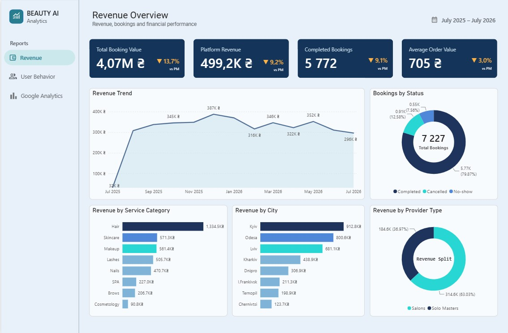
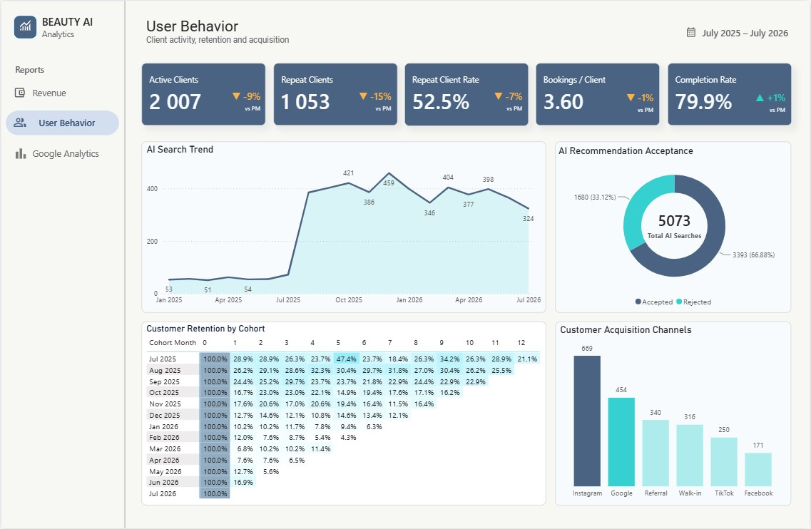
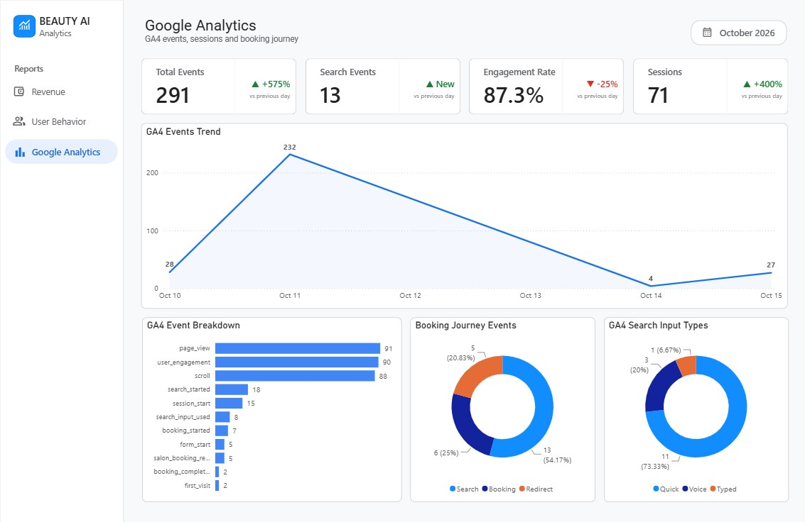

# Beauty AI — Power BI Analytics Dashboard

### Revenue, Customer Behavior & Google Analytics 4

A three-page interactive Power BI dashboard developed for **Beauty AI**, a beauty services booking platform.

The project combines financial performance, customer behavior, AI-powered search analytics, and Google Analytics 4 event data to support data-driven business decisions.

**Tech Stack:** Power BI | SQL | Google BigQuery | Google Analytics 4 | DAX | Power Query

---

## Project Objectives

The goal of this project is to transform business and user activity data into actionable insights.

Key analytical objectives:

- Track booking value and platform revenue.
- Evaluate booking completion and financial performance.
- Compare revenue generated by salons and independent masters.
- Analyze customer retention and repeat booking behavior.
- Measure AI recommendation effectiveness.
- Identify customer acquisition channels.
- Monitor website engagement, search interactions, and booking journey events.

---

## Tech Stack

| Technology | Purpose |
|---|---|
| Power BI | Interactive dashboards and KPI visualization |
| Google BigQuery | Cloud data storage and SQL analysis |
| SQL | Data querying, filtering, and aggregation |
| Google Analytics 4 | Website behavior and event tracking |
| DAX | Measures, calculated columns, and business metrics |
| Power Query | Data cleaning and transformation |

---

## Dashboard 1 — Revenue Overview

This dashboard provides an overview of booking performance, platform earnings, and revenue distribution.

### Key Performance Indicators

| KPI | Value |
|---|---:|
| Total Booking Value | 4.07M UAH |
| Platform Revenue | 499.2K UAH |
| Completed Bookings | 5,772 |
| Average Order Value | 705 UAH |

**Total Booking Value** represents the total value of services booked through the platform.

**Platform Revenue** represents revenue earned by the platform, rather than the full value of customer bookings.

### Revenue Analysis

The dashboard includes:

- **Revenue Trend:** monthly booking value trends.
- **Bookings by Status:** completed, cancelled, and no-show bookings.
- **Revenue by Service Category:** financial performance across beauty services.
- **Revenue by City:** geographic distribution of booking value.
- **Revenue by Provider Type:** platform revenue distribution between salons and solo masters.

### Revenue Split

| Provider Type | Platform Revenue | Share |
|---|---:|---:|
| Salons | 314.6K UAH | 63.03% |
| Solo Masters | 184.6K UAH | 36.97% |

### Key Insights

- Salons generate the largest share of platform revenue.
- Hair services lead in total booking value.
- Kyiv is the highest-performing city by booking value.
- The booking completion rate is approximately 79.9%.
- Revenue and booking KPIs indicate a decline compared with the previous month.

---

## Dashboard 2 — User Behavior

This dashboard focuses on customer activity, retention, acquisition, and AI recommendation performance.

### Key Performance Indicators

| KPI | Value |
|---|---:|
| Active Clients | 2,007 |
| Repeat Clients | 1,053 |
| Repeat Client Rate | 52.5% |
| Bookings per Client | 3.60 |
| Booking Completion Rate | 79.9% |

### Customer Behavior Analysis

**AI Search Trend**

Tracks changes in AI-powered search activity over time, helping identify adoption patterns and usage trends.

**AI Recommendation Acceptance**

Measures how frequently users accept AI-generated recommendations.

| Metric | Value |
|---|---:|
| Total AI Searches | 5,073 |
| Accepted Recommendations | 3,393 |
| Rejected Recommendations | 1,680 |
| Acceptance Rate | 66.88% |

**Customer Retention by Cohort**

A cohort analysis matrix visualizes customer retention across monthly acquisition cohorts.

It helps identify:

- Customer retention patterns over time.
- Differences between acquisition cohorts.
- Opportunities to improve long-term customer engagement.

**Customer Acquisition Channels**

Analyzes where customers originate, including:

- Instagram
- Google
- Referral
- Walk-in
- TikTok
- Facebook

### Key Insights

- More than half of active clients are repeat customers.
- Approximately two-thirds of AI recommendations are accepted.
- Instagram is the leading customer acquisition channel.
- Cohort analysis highlights differences in customer retention across periods.

---

## Dashboard 3 — Google Analytics 4

The Google Analytics dashboard analyzes website interaction events, engagement, search methods, and booking journey activity.

Unlike the historical revenue and customer dashboards, this page focuses on a shorter GA4 observation period in October 2026.

### Key Performance Indicators

| KPI | Value |
|---|---:|
| Total Events | 291 |
| Search Events | 13 |
| Engagement Rate | 87.3% |
| Sessions | 71 |

### GA4 Events Trend

Visualizes daily event activity to identify traffic fluctuations and changes in user engagement.

### Event Breakdown

Tracks interactions such as:

- `page_view`
- `user_engagement`
- `scroll`
- `search_started`
- `session_start`
- `search_input_used`
- `booking_started`
- `form_start`

### Booking Journey Analysis

Groups GA4 events into three behavioral categories:

| Stage | Share |
|---|---:|
| Search | 54.17% |
| Booking | 25.00% |
| Redirect | 20.83% |

This view helps examine the distribution of tracked interactions throughout the booking journey.

These percentages describe event distribution, not a unique-user conversion funnel.

### Search Input Analysis

Compares the methods used to interact with the search functionality.

| Search Type | Events | Share |
|---|---:|---:|
| Quick | 11 | 73.33% |
| Voice | 3 | 20.00% |
| Typed | 1 | 6.67% |

### Key Insights

- Quick Search is the most frequently tracked search input type.
- Voice Search accounts for 20% of recorded search input events.
- Engagement Rate reaches 87.3% in the displayed reporting period.
- GA4 provides additional behavioral context alongside financial and customer data.

**Note:** GA4 results are based on a relatively small event sample and should be interpreted as preliminary behavioral observations rather than long-term trends.

---

## Data Workflow

The analytics workflow combines business reporting data and website interaction events.

### Business Analytics

Business data is prepared and modeled to calculate financial and customer KPIs, including:

- Booking value and platform revenue.
- Completed bookings and average order value.
- Customer activity and repeat client rate.
- AI recommendation acceptance.
- Customer retention cohorts.
- Acquisition channel performance.

### Google Analytics Pipeline

1. Collect website interaction events using GA4.
2. Process GA4 event data in Google BigQuery.
3. Prepare and transform data using SQL and Power Query.
4. Create calculated columns and measures using DAX.
5. Build interactive Power BI visualizations.
6. Analyze user interactions and booking-related activity.

### BigQuery Data Sources

**Google Cloud Project:** `beauty-ai-analytics`

GA4-related tables:

- `GA4_Raw_Events`
- `GA4_Search_Types`

These tables support event analysis, search input classification, and booking journey reporting.

---

## Business Questions Answered

The project helps explore:

1. How much booking value and platform revenue is generated?
2. Which service categories and cities contribute the most?
3. How is platform revenue distributed between salons and solo masters?
4. What percentage of bookings are completed?
5. How many customers return to the platform?
6. How does retention change across customer cohorts?
7. How effective are AI-powered recommendations?
8. Which acquisition channels attract the most customers?
9. Which search methods do users prefer?
10. How do recorded user events relate to the booking journey?

---

## Skills Demonstrated

- SQL querying and data aggregation
- Data cleaning and transformation
- Power BI data modeling
- DAX calculations and KPI development
- Financial and operational reporting
- Customer retention and cohort analysis
- Customer acquisition analytics
- GA4 event analysis
- Search behavior analysis
- Dashboard design and data storytelling
- Business-oriented analytical thinking

---

## Project Summary

Beauty AI Analytics demonstrates an end-to-end business intelligence approach by combining financial, customer, and website interaction data into three interactive Power BI dashboards.

The project highlights practical experience in **Power BI, SQL, Google BigQuery, Google Analytics 4, DAX, and data visualization**, with an emphasis on translating data into measurable business insights.

---

**Project Type:** Data Analytics Portfolio Project

**Tools:** Power BI · SQL · BigQuery · GA4 · DAX · Power Query
