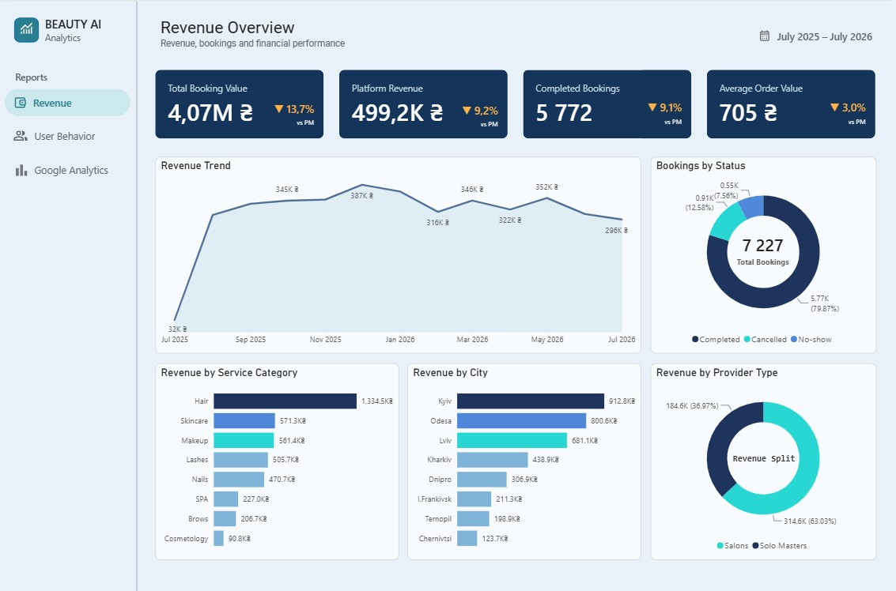
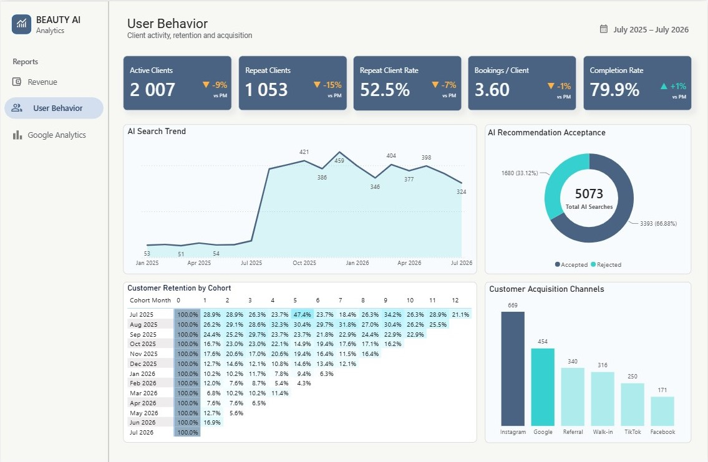

# Beauty AI — Power BI Analytics Dashboard

### Revenue & User Behavior Analytics | Data Analytics Portfolio Project

An interactive Power BI analytics project designed to analyze business revenue, service provider performance, and user behavior for **Beauty AI**, a beauty services booking platform.

The project demonstrates an end-to-end analytics workflow using **Google Analytics 4, Google BigQuery, SQL, Power BI, and DAX**.

## Project Objectives

The main goal is to transform business and user interaction data into actionable insights.

Key objectives:
- Monitor revenue and business performance.
- Analyze revenue distribution between salons and independent beauty professionals.
- Identify top-performing service categories and cities.
- Understand how users interact with the platform.
- Analyze search behavior and booking conversion.
- Support data-driven business decisions.

## Tech Stack

| Technology | Purpose |
|---|---|
| Power BI | Data visualization and interactive dashboards |
| Google BigQuery | Cloud data storage and SQL analysis |
| SQL | Data extraction, transformation, and aggregation |
| Google Analytics 4 | Website event tracking and behavioral analytics |
| DAX | Calculated measures, columns, and KPIs |
| Power Query | Data preparation and transformation |

## Dashboard 1 — Revenue Overview

The Revenue Overview dashboard provides insights into the platform's financial performance.

### Key Metrics

- **Total Revenue** — overall generated revenue.
- **Total Bookings** — number of completed bookings.
- **Average Booking Value** — average revenue per booking.
- **Commission Revenue** — platform revenue generated through commissions.

### Revenue Analysis

The dashboard includes:
- Revenue trends over time.
- Revenue by service category.
- Revenue by city.
- Revenue distribution by provider type.

### Revenue Split

| Provider Type | Revenue | Share |
|---|---:|---:|
| Salons | 314.6K UAH | 63.03% |
| Solo Masters | 184.6K UAH | 36.97% |

**Business Insight:** Salons generate the majority of total revenue, while independent beauty professionals contribute a significant share of platform activity.

## Dashboard 2 — User Behavior Overview

The User Behavior dashboard focuses on understanding user interactions, search preferences, and the customer booking journey.

### Key Areas of Analysis

**User Engagement**
- Website traffic and user activity.
- Engagement indicators.
- User interaction patterns.

**Search Behavior**

Search interactions are classified into three categories:

- **Quick** — quick search interactions.
- **Voice** — voice search interactions.
- **Typed** — manually entered search queries.

This classification helps evaluate how users prefer to discover beauty services.

**Booking Journey**

The booking journey analysis tracks user interactions across the booking process to identify potential conversion opportunities and areas for improvement.

## Google Analytics 4 Integration

Google Analytics 4 is used to collect and analyze user interaction events.

The analytics workflow connects behavioral tracking with business reporting to provide a broader understanding of platform performance.

### Data Processing

The project includes:

1. Collection of website interaction events in GA4.
2. Data processing and querying in Google BigQuery.
3. Data transformation using SQL and Power Query.
4. Creation of calculated columns and measures using DAX.
5. Development of interactive Power BI dashboards.
6. Interpretation of business and user behavior metrics.

### BigQuery Data Sources

Project: `beauty-ai-analytics`

Key tables:
- `GA4_Raw_Events`
- `GA4_Search_Types`

These datasets support behavioral analysis, search classification, and booking journey reporting.

## Analytical Skills Demonstrated

- Data cleaning and transformation
- SQL querying and aggregation
- Data modeling
- DAX measures and calculated columns
- KPI development
- Revenue analytics
- Funnel and user behavior analysis
- Data visualization
- Business insight generation

## Business Value

The dashboards help answer important business questions:

- Which provider type generates the most revenue?
- Which service categories perform best?
- How does revenue vary across cities?
- Which search methods do customers prefer?
- How do users move through the booking journey?
- Where are the opportunities to improve conversion and business performance?

## Project Summary

This project demonstrates the ability to combine financial and behavioral data into a unified analytics solution.

It highlights practical skills in **SQL, Google BigQuery, GA4, Power BI, DAX, and business analytics**, with a focus on transforming raw data into meaningful insights for decision-making.

---

**Tools:** Power BI · SQL · Google BigQuery · Google Analytics 4 · DAX · Power Query

**Project Type:** Data Analytics Portfolio Project
